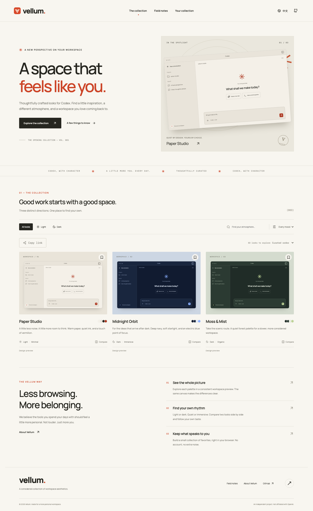
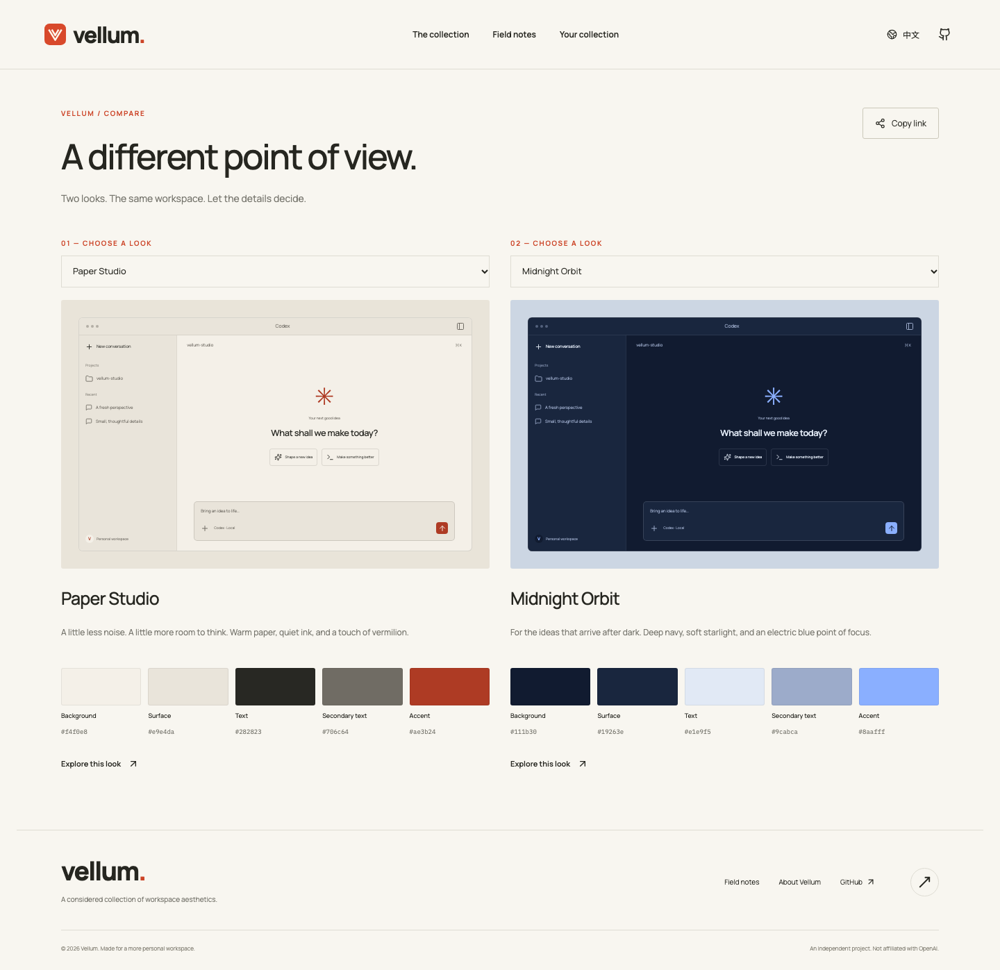
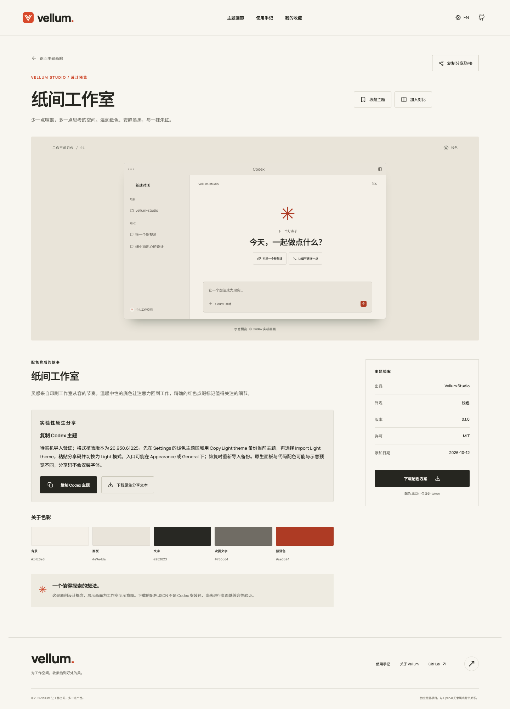
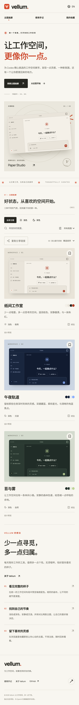

<div align="center">


# Vellum

**A space that feels like you.**

A considered collection of Codex workspace aesthetics.

**English** · [简体中文](README.zh-CN.md)

[**Visit Vellum →**](https://vellum.wayback654.chatgpt.site/en)

[](https://github.com/carefreelove/vellum/actions/workflows/ci.yml)
[](LICENSE)


[Features](#features) · [Quick start](#quick-start) · [Architecture](#architecture) · [Deployment](#deployment) · [Contributing](#contributing)

</div>



Vellum is an independent, bilingual gallery for people who want a more personal Codex workspace. It pairs an editorial, paper-inspired interface with a small opening collection, consistent workspace previews, side-by-side comparison, and browser-local favorites.

> **Current scope:** three original design concepts with illustrative previews, not live Codex screenshots. Palette JSON is reference design data. Paper Studio additionally offers experimental native share text awaiting actual app verification. The website never changes Codex automatically.

## v0.2 changes

- **Shareable state:** language lives in `/en/` and `/zh/` routes; search, appearance, mood and sort persist in the URL. Comparison links carry two theme IDs in `themes`, independent of the recipient's saved collection.
- **Page metadata:** server-generated localized titles, descriptions, Open Graph, canonical and hreflang tags; sitemap and robots.txt; real HTTP 404s for missing pages and themes. React still renders the page body in the browser.
- **Native sharing experiment:** Paper Studio offers copy/download of `codex-theme-v1:` text, with backup, import and restoration instructions. The format was inspected read-only against desktop build 26.930.61225; **actual app import remains unverified**. This is not one-click installation. The other two looks remain design previews.
- **Structure and tests:** dedicated pages, components and hooks; 16 API/content/metadata tests and 12 desktop/mobile Chromium scenarios; browser checks run in GitHub Actions.
- **Hosting adapter:** local Express + SQLite remains available. Sites runs Vinext + Cloudflare D1 and reuses the catalog, query validation, native serialization and metadata rules.

Example links: `/en/?mode=dark&mood=organic` and `/en/compare?themes=paper-studio,midnight-orbit`. Favorites remain browser-local; an explicit language URL overrides the stored preference.

See the [feasibility record](docs/THEME-FEASIBILITY.md) for field mappings and verification limits. Native panels and syntax colors can differ from the illustrative preview; the share text does not install fonts.

## Features

| Feature                   | What works today                                                                                                           |
| ------------------------- | -------------------------------------------------------------------------------------------------------------------------- |
| Curated gallery           | Three original looks, with room to expand the catalog                                                                      |
| Bilingual interface       | English / Simplified Chinese navigation, content, labels, help, and feedback; remembered language choice                   |
| Search and filtering      | Search both languages; combine light/dark appearance with mood; curated, newest, and English name ordering                 |
| Theme details             | Consistent full workspace illustration, design story, palette, version, license, and explicit concept status               |
| Palette tools             | Copy individual hex colors and download a named JSON file from the backend                                                 |
| Compare                   | Select up to two looks; change either choice on the comparison page                                                        |
| Personal collection       | Save and remove favorites, with persistence in the current browser                                                         |
| Field notes               | Browsing instructions, current installation boundary, expandable FAQs                                                      |
| Responsive UI             | Desktop grid, tablet layout, and mobile stacking                                                                           |
| Accessibility foundations | Semantic controls, keyboard focus, skip link, live feedback, descriptive labels, reduced-motion support                    |
| Real backend              | Express API, persistent SQLite catalog, automatic initialization, validated query parameters, parameterized detail lookups |
| Developer foundation      | TypeScript build, API integration tests, GitHub Actions, Docker deployment recipe, two full READMEs                        |

There is intentionally **no Create editor**, public upload form, login system, or pretend installation button. Favorites do not sync between devices. No analytics or tracking cookies are included.

### Opening collection

| Look                      | Appearance | Mood            | Status         |
| ------------------------- | ---------- | --------------- | -------------- |
| Paper Studio / 纸间工作室 | Light      | Minimal, warm   | Design concept |
| Midnight Orbit / 午夜轨道 | Dark       | Immersive, cool | Design concept |
| Moss & Mist / 苔与雾      | Dark       | Organic, calm   | Design concept |

### A fair comparison

All previews share the same workspace layout so differences in color are easy to judge.



<details>
<summary>Chinese detail page and mobile preview</summary>





</details>

## Quick start

Requirements: **Node.js 24+** and **pnpm 11.25.0**. No API key, paid service, or external database is required.

```bash
git clone https://github.com/carefreelove/vellum.git
cd vellum
npm install --global pnpm@11.25.0
pnpm install --frozen-lockfile
pnpm dev
```

Open the Local URL printed by Vite, normally `http://127.0.0.1:5173`. Vite proxies `/api` to the backend at port `3001`. The database is initialized automatically on startup.

```bash
# Test and build
pnpm test
pnpm build
pnpm exec playwright install chromium
pnpm test:e2e

# Serve the production build and API together
pnpm start
```

The production server defaults to `http://127.0.0.1:3001`. Run commands from the repository root. In development, keep the API on port 3001 unless you also change `vite.config.ts`.

### Commands

| Command           | Purpose                                                    |
| ----------------- | ---------------------------------------------------------- |
| `pnpm dev`        | Start client and API together; Ctrl+C stops both           |
| `pnpm dev:client` | Start Vite only                                            |
| `pnpm dev:server` | Start API with Node watch mode                             |
| `pnpm test`       | Run API, query validation, download, and persistence tests |
| `pnpm build`      | Type-check and build production assets                     |
| `pnpm check`      | Run tests and production build                             |
| `pnpm start`      | Serve built frontend and API in one process                |
| `pnpm db:seed`    | Initialize the catalog; existing entries are preserved     |

`pnpm test:e2e` requires `pnpm build` first. Tests start an isolated server on port 4175 and an in-memory database; existing data is untouched.

### Configuration

Optionally copy `.env.example` to `.env`. The server reads it on startup; existing process environment variables take precedence.

| Variable        | Default                 | Description                                                       |
| --------------- | ----------------------- | ----------------------------------------------------------------- |
| `HOST`          | `127.0.0.1`             | Use `0.0.0.0` inside a container or behind a remote reverse proxy |
| `PORT`          | `3001`                  | HTTP listening port                                               |
| `DATABASE_PATH` | `./data/gallery.sqlite` | Persistent SQLite file                                            |

Set `PUBLIC_ORIGIN` to the actual HTTPS production origin for canonical, hreflang and sitemap links. The local default is `http://localhost:3001`.

Never commit `.env` or runtime database files. Both are ignored by Git.

## Architecture

```text
Browser: React 19 + TypeScript + Vite
    ├── Gallery, details, compare, favorites, guide, about
    ├── Bilingual copy and original theme content
    └── localStorage: language / saved IDs / comparison IDs
                         │ same-origin HTTP
Node.js 24 + Express 5   │
    ├── GET /api/health
    ├── GET /api/themes
    ├── GET /api/themes/:id
    └── GET /api/themes/:id/palette
                         │ prepared statements
SQLite (node:sqlite, WAL mode, persistent disk)
```

```text
src/
  App.tsx                   Page routing and shared shell
  pages/                    Separate page views
  hooks/                    Gallery state, URL filters and location
  components/Workspace.tsx   Shared illustrative workspace
  i18n.ts                   Complete English / Chinese interface copy
  types.ts                  Theme and locale types
  lib/storage.ts            Guarded browser storage
  style.css                 Responsive editorial design system
server/
  app.mjs                   Node API and HTML entry serving
  catalog.mjs               Portable query and download rules
  page.mjs                  Localized server HTML metadata
  database.mjs              Database initialization and queries
  themes.mjs                Original bilingual seed catalog
  index.mjs                 Server entry and graceful shutdown
tests/api.test.mjs          Integration tests against a real HTTP server
e2e/                       Playwright desktop and mobile scenarios
hosting/                   Sites overlay and D1 migration history
docs/                      Architecture notes, QA record, screenshots
.github/workflows/ci.yml    Clean install, tests, and build
```

The UI fetches the catalog from the API and filters the small collection in memory. The API also supports equivalent query parameters for external consumers. Pages use normal URLs; Express serves their entry points in production. This release is a client-rendered app, not an SSR application.

### API reference

| Method | Endpoint                           | Response                                                        |
| ------ | ---------------------------------- | --------------------------------------------------------------- |
| GET    | `/api/health`                      | `{ "status": "ok", "schemaVersion": 1 }` after a database check |
| GET    | `/api/themes`                      | `{ "items": [...], "total": 3 }`                                |
| GET    | `/api/themes/paper-studio`         | Complete bilingual theme record                                 |
| GET    | `/api/themes/paper-studio/palette` | JSON attachment named `paper-studio.palette.json`               |

Additional endpoints: `GET /api/themes/paper-studio/native` returns the native share text attachment; other themes currently return 404. `GET /sitemap.xml` and `GET /robots.txt` expose indexing information.

Catalog parameters: `q` (up to 100 characters), `mode=all|light|dark`, `mood=all|minimal|immersive|organic`, `sort=curated|newest|name`.

```bash
curl 'http://127.0.0.1:3001/api/themes?mode=dark&mood=organic'
curl -OJ 'http://127.0.0.1:3001/api/themes/paper-studio/palette'
```

Invalid parameters return HTTP 400 with `INVALID_QUERY`; missing themes return 404 with `THEME_NOT_FOUND`. Unknown API routes return JSON 404. Internal failures return `INTERNAL_ERROR` without returning a stack trace to the browser.

## Deployment

**Public deployment:** [Vellum](https://vellum.wayback654.chatgpt.site/en), hosted on Sites / Cloudflare Worker + D1. GitHub hosts the source; the Node + SQLite self-hosted option remains available independently.

See [hosting instructions](docs/HOSTING.md) for the Sites adapter and publication workflow. The Node deployment remains independently usable; GitHub Pages cannot run the database backend.

> 2026-10-13: the platform confirms a successful public deployment, but this network received an upstream Cloudflare 403. Public page/API end-to-end acceptance remains incomplete. See the [QA record](docs/QA.md#发布记录--production-publication).

### Node host

```bash
pnpm install --frozen-lockfile
pnpm build
HOST=0.0.0.0 PORT=3001 DATABASE_PATH=/persistent/vellum.sqlite PUBLIC_ORIGIN=https://your-domain.example pnpm start
```

Ensure the database directory is writable by the service user. Preserve the SQLite file across redeployments, and use a SQLite-aware backup process. The default seed inserts missing IDs but never overwrites existing records. Use a single app instance for this version; multi-instance scaling should move the catalog to a shared database.

### Docker recipe

```bash
docker compose up --build -d
curl http://127.0.0.1:3001/api/health
```

The recipe runs as the unprivileged `node` user and persists the catalog in the `vellum-data` named volume. The compose port is bound to loopback; place an HTTPS reverse proxy in front of it for public access. `docker compose down` preserves the volume; `down -v` removes it. See [QA notes](docs/QA.md) for what has actually been verified, including the Docker verification boundary.

## Design and content

- Warm paper `#f8f6f0`, ink `#262620`, vermilion `#cc4427`.
- Manrope for English, Noto Sans SC for Chinese, IBM Plex Mono for small technical labels.
- Fonts are self-hosted; there are no Google Fonts runtime requests.
- Workspace previews are code-rendered illustrations; no screenshots or theme assets were copied from the reference site.
- Original code and palettes: [MIT](LICENSE). Font licenses are retained under [`public/licenses`](public/licenses).
- Discovery flow inspiration: [CodexThemes](https://codexthemes.ai/). Vellum is an independent project and is not affiliated with or endorsed by OpenAI or CodexThemes.

## Contributing

1. Fork the repository and create a feature branch.
2. Keep interface copy paired in `src/i18n.ts`; provide both languages for catalog content.
3. Add an original theme record in `server/themes.mjs` and its type support if necessary. Newly added IDs are seeded on the next startup. Existing IDs are not overwritten; use a deliberate database migration for updates. In a disposable development environment, start with a new `DATABASE_PATH` to preview changed seeds without touching existing data.
4. Preserve explicit preview/installation status. Do not label a concept as a verified installable package.
5. Run `pnpm check` and inspect desktop/mobile layouts. See [QA notes](docs/QA.md).
6. Submit a pull request with screenshots for UI changes.

### Possible next steps

Verified installable theme packages and compatibility metadata, protected catalog administration, reviewed creator submissions, asset storage, and optional account-based favorites sync. These are future extensions, not features already shipped.

---

[切换到简体中文 →](README.zh-CN.md)
