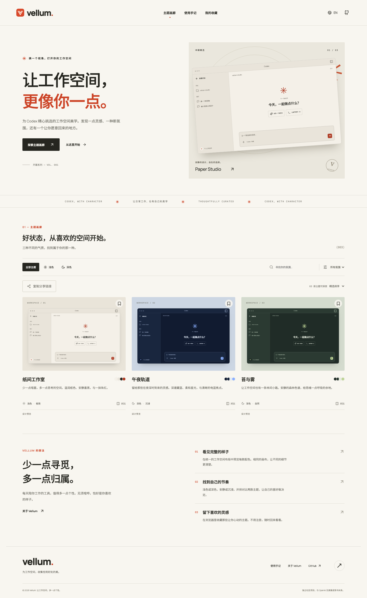

<div align="center">


# Vellum

**让工作空间，更像你一点。**

为 Codex 工作空间，收集恰到好处的美。

[English](README.md) · **简体中文**

[**在线体验 →**](https://vellum.wayback654.chatgpt.site/zh)

[](https://github.com/carefreelove/vellum/actions/workflows/ci.yml)
[](LICENSE)


[功能](#功能) · [快速启动](#快速启动) · [架构](#架构) · [部署](#部署) · [参与贡献](#参与贡献)

</div>



Vellum 是一个独立、开源的双语 Codex 装饰主题画廊。采用米白、墨黑与橙红构成的编辑设计风格，以少量精选主题、统一的工作空间预览、双主题对比和本地收藏，帮助你找到喜欢的工作氛围。

> **当前边界：**3 款原创设计概念；预览不是 Codex 实机截图。配色 JSON 是参考设计 token。纸间工作室另提供实验性原生分享文本，待实机导入验证。网站不会自动修改 Codex。

## v0.2 更新

- **可分享状态**：语言使用 `/zh/`、`/en/` 路径；搜索、模式、氛围、排序保存在 URL；对比页通过 `themes` 参数分享两款主题。接收者无需预先收藏。
- **页面信息**：服务端生成双语 title、description、Open Graph、canonical 与 hreflang；提供 sitemap 和 robots.txt；未知页面及主题返回真实 HTTP 404。正文仍由 React 在浏览器渲染。
- **原生分享试验**：纸间工作室可复制或下载 `codex-theme-v1:` 文本，配有备份、导入与恢复说明。按桌面构建 26.930.61225 只读核验格式，**没有完成真实应用导入验证**；不是一键安装。其他两款仍为设计预览。
- **结构与测试**：拆分 pages、components 与 hooks；16 项 API／内容／元数据测试，12 项桌面和手机 Chromium 场景；GitHub Actions 执行构建与浏览器测试。
- **部署适配**：本地保留 Express + SQLite；Sites 使用 Vinext + Cloudflare D1，复用主题数据、查询校验、分享码和页面信息生成规则。

分享示例：`/zh/?mode=dark&mood=organic`、`/en/compare?themes=paper-studio,midnight-orbit`。收藏仍只保存在当前浏览器；语言路径优先于本地偏好。

原生分享的支持字段和验证边界详见 [可行性记录](docs/THEME-FEASIBILITY.md)。原生面板和代码语法配色可能不同于网页示意图，分享文本不会安装字体。

## 功能

| 功能       | 当前实现                                                                        |
| ---------- | ------------------------------------------------------------------------------- |
| 精选画廊   | 3 款原创主题概念，目录结构可继续扩充                                            |
| 完整双语   | 中英文导航、内容、标签、说明、反馈；记住语言选择                                |
| 搜索与筛选 | 同时搜索中英文；明暗模式与氛围组合筛选；精选、最近添加、英文名排序              |
| 主题详情   | 统一布局预览、设计故事、完整色板、版本、许可和概念状态                          |
| 配色工具   | 点击复制单个 HEX 颜色；从后端下载有文件名的配色 JSON                            |
| 双主题对比 | 最多选两款，使用相同布局比较，可在对比页替换选择                                |
| 我的收藏   | 收藏、取消收藏，在当前浏览器中持久保存                                          |
| 使用手记   | 浏览流程、安装能力边界和可展开的常见问题                                        |
| 响应式界面 | 桌面网格、平板布局、手机纵向浏览                                                |
| 无障碍基础 | 语义化控件、键盘焦点、跳至正文、状态播报、描述标签、减少动态效果支持            |
| 实际后端   | Express API、SQLite 持久化目录、自动初始化、查询参数校验与参数化查询            |
| 工程基础   | TypeScript 构建、API 集成测试、GitHub Actions、Docker 部署配置、完整双语 README |

首版明确**不包含 Create 编辑器**、公开上传表单、账号登录或虚假的一键安装按钮。收藏不跨设备同步。应用不包含分析追踪或跟踪 Cookie。

### 开篇系列

| 主题                      | 外观 | 氛围       | 状态     |
| ------------------------- | ---- | ---------- | -------- |
| 纸间工作室 / Paper Studio | 浅色 | 极简、温暖 | 设计概念 |
| 午夜轨道 / Midnight Orbit | 深色 | 沉浸、冷色 | 设计概念 |
| 苔与雾 / Moss & Mist      | 深色 | 自然、平静 | 设计概念 |

### 在相同画布中比较

所有主题使用一致的预览布局，让配色差异更容易判断。


<details>
<summary>查看主题详情与手机端截图</summary>


</details>

## 快速启动

环境要求：**Node.js 24+**、**pnpm 11.25.0**。不需要 API key、付费服务或外部数据库。

```bash
git clone https://github.com/carefreelove/vellum.git
cd vellum
npm install --global pnpm@11.25.0
pnpm install --frozen-lockfile
pnpm dev
```

打开 Vite 输出的 Local 地址，通常为 `http://127.0.0.1:5173`。开发服务器将 `/api` 转发至 `3001` 端口的后端。首次启动会自动建表并初始化主题。

```bash
# 测试与构建
pnpm test
pnpm build
pnpm exec playwright install chromium
pnpm test:e2e

# 同一进程提供生产前端与 API
pnpm start
```

生产服务默认地址为 `http://127.0.0.1:3001`。所有命令均在仓库根目录执行。开发时建议保持 API 端口为 3001；若更改，请同步修改 `vite.config.ts` 的代理。

### 常用命令

| 命令              | 用途                                  |
| ----------------- | ------------------------------------- |
| `pnpm dev`        | 同时启动前端与后端；Ctrl+C 停止两者   |
| `pnpm dev:client` | 单独启动 Vite                         |
| `pnpm dev:server` | 单独启动带 watch 模式的 API           |
| `pnpm test`       | API、参数校验、下载、数据库持久化测试 |
| `pnpm build`      | TypeScript 类型检查及生产构建         |
| `pnpm check`      | 测试后构建                            |
| `pnpm start`      | 提供已构建前端与 API                  |
| `pnpm db:seed`    | 初始化主题目录，保留已有条目          |

`pnpm test:e2e` 需先运行 `pnpm build`；测试自动启动独立端口 4175 和内存数据库，不读取个人收藏或现有数据库。

### 环境配置

可以复制 `.env.example` 为 `.env`。服务启动时读取该文件，已有进程环境变量优先。

| 变量            | 默认值                  | 说明                                   |
| --------------- | ----------------------- | -------------------------------------- |
| `HOST`          | `127.0.0.1`             | 容器或远程反向代理后通常使用 `0.0.0.0` |
| `PORT`          | `3001`                  | HTTP 监听端口                          |
| `DATABASE_PATH` | `./data/gallery.sqlite` | SQLite 持久化文件位置                  |

生产环境设置 `PUBLIC_ORIGIN` 为实际 HTTPS 域名，用于 canonical、hreflang 和 sitemap；本地默认为 `http://localhost:3001`。

不要提交 `.env` 或运行中的数据库文件；它们已加入 `.gitignore`。

## 架构

```text
浏览器：React 19 + TypeScript + Vite
    ├── 画廊、详情、对比、收藏、使用手记、关于
    ├── 中英文界面及原创主题内容
    └── localStorage：语言 / 收藏 ID / 对比 ID
                         │ 同源 HTTP
Node.js 24 + Express 5   │
    ├── GET /api/health
    ├── GET /api/themes
    ├── GET /api/themes/:id
    └── GET /api/themes/:id/palette
                         │ 参数化查询
SQLite（node:sqlite、WAL 模式、持久磁盘）
```

```text
src/
  App.tsx                   页面路由与公共外壳
  pages/                    各页面视图
  hooks/                    目录状态、URL 筛选与定位
  components/Workspace.tsx   共用的工作空间示意预览
  i18n.ts                   完整中英文界面文案
  types.ts                  主题与语言类型
  lib/storage.ts            带异常保护的浏览器存储
  style.css                 响应式编辑设计系统
server/
  app.mjs                   Node API 与 HTML 入口服务
  catalog.mjs               可复用查询与下载规则
  page.mjs                  双语服务端页面信息
  database.mjs              数据库初始化与查询
  themes.mjs                原创双语主题种子
  index.mjs                 服务入口与退出清理
tests/api.test.mjs          使用实际 HTTP 服务的集成测试
e2e/                       Playwright 桌面与手机场景
hosting/                   Sites 适配层与 D1 迁移
docs/                      架构说明、验收记录与页面截图
.github/workflows/ci.yml    全新安装、测试与构建
```

前端从 API 获取目录，在浏览器中筛选首版的小规模数据集；后端也提供等价查询参数，供外部调用。页面使用独立 URL，生产环境由 Express 返回对应前端入口。当前是客户端渲染应用，不是 SSR 网站。

### API 文档

| 方法 | 路径                               | 返回内容                                                  |
| ---- | ---------------------------------- | --------------------------------------------------------- |
| GET  | `/api/health`                      | 检查数据库后返回 `{ "status": "ok", "schemaVersion": 1 }` |
| GET  | `/api/themes`                      | `{ "items": [...], "total": 3 }`                          |
| GET  | `/api/themes/paper-studio`         | 完整双语主题数据                                          |
| GET  | `/api/themes/paper-studio/palette` | 名为 `paper-studio.palette.json` 的 JSON 附件             |

额外端点：`GET /api/themes/paper-studio/native` 返回原生分享文本附件；其他主题暂返回 404。`GET /sitemap.xml` 与 `GET /robots.txt` 提供索引入口。

目录参数：`q`（最多 100 字符）、`mode=all|light|dark`、`mood=all|minimal|immersive|organic`、`sort=curated|newest|name`。

```bash
curl 'http://127.0.0.1:3001/api/themes?mode=dark&mood=organic'
curl -OJ 'http://127.0.0.1:3001/api/themes/paper-studio/palette'
```

参数不合法返回 HTTP 400 和 `INVALID_QUERY`；主题不存在返回 404 和 `THEME_NOT_FOUND`；未知 API 路径返回 JSON 404；内部错误返回 `INTERNAL_ERROR`，不向浏览器泄露堆栈。

## 部署

**公开网站已部署：**[Vellum](https://vellum.wayback654.chatgpt.site/zh)，使用 Sites / Cloudflare Worker + D1。GitHub 保存源码；Node + SQLite 自托管方式仍可独立使用。

Sites 适配层构建与发布步骤见 [部署说明](docs/HOSTING.md)。Node 部署仍独立可用，GitHub Pages 不能直接运行数据库后端。

> 2026-10-13：平台确认部署成功且为 public，但本次网络访问被 Cloudflare 403 拦截，公开页面与 API 的端到端验收待完成。详情见 [QA 记录](docs/QA.md#发布记录--production-publication)。

### Node 主机

```bash
pnpm install --frozen-lockfile
pnpm build
HOST=0.0.0.0 PORT=3001 DATABASE_PATH=/persistent/vellum.sqlite PUBLIC_ORIGIN=https://your-domain.example pnpm start
```

数据库目录必须允许服务用户写入；重新部署时保留 SQLite 文件，并使用适合 SQLite 的一致性备份方式。默认播种只插入不存在的 ID，不覆盖已有数据。当前版本适合单实例；多实例横向扩展时，应将目录迁移到共享数据库。

### Docker 配置

```bash
docker compose up --build -d
curl http://127.0.0.1:3001/api/health
```

容器以非 root 的 `node` 用户运行，数据库保存在 `vellum-data` 命名卷中。Compose 端口默认只绑定本机；公开访问时应接入 HTTPS 反向代理。`docker compose down` 保留卷，`down -v` 会移除卷。实际验收范围（包括 Docker 是否实测）见 [QA 记录](docs/QA.md)。

## 设计与素材

- 纸白 `#f8f6f0`、墨黑 `#262620`、朱红 `#cc4427`。
- 英文 Manrope、中文 Noto Sans SC、技术标签 IBM Plex Mono。
- 字体随网站提供，运行时不请求 Google Fonts。
- 预览为代码绘制的示意图，没有复制参考站截图或主题素材。
- 原创代码与配色采用 [MIT](LICENSE)，字体许可证保留在 [`public/licenses`](public/licenses)。
- 浏览流程参考 [CodexThemes](https://codexthemes.ai/)。Vellum 是独立项目，与 OpenAI、CodexThemes 无隶属或背书关系。

## 参与贡献

1. Fork 仓库并创建功能分支。
2. 修改界面时，同步维护 `src/i18n.ts` 的中英文文案；主题内容也需提供双语版本。
3. 在 `server/themes.mjs` 添加原创主题记录，必要时补充类型支持。新 ID 会在下次启动时加入数据库；已有 ID 不会被覆盖，更新应使用明确的数据迁移。开发时可以指定新的 `DATABASE_PATH` 来验证修改后的种子，避免影响已有数据。
4. 保留明确的预览／安装状态，不把概念主题标记成已验证的可安装包。
5. 执行 `pnpm check`，检查桌面和手机布局，参考 [QA 记录](docs/QA.md)。
6. 提交 Pull Request；界面修改附上截图。

### 后续可扩展方向

经过验证的可安装主题包及兼容性信息、受保护的目录管理、创作者投稿审核、素材存储，以及可选的账号收藏同步。这些属于后续方向，不是首版已实现功能。

---

[Switch to English →](README.md)
